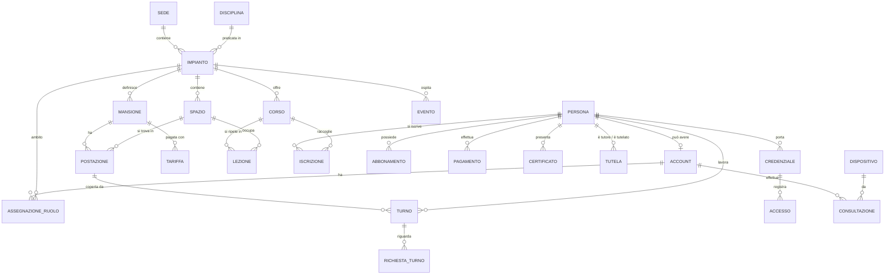

# Leone Gestionale – architettura

Stato: 19 ottobre 2026 · fasi 1 (turni dello staff) e 2 (piano vasca) completate, con versione PC e programma per Windows. Da confrontare con il gestionale attuale prima della fase 3.

## Obiettivo

Un gestionale per la società sportiva, pensato per essere **proposto alla società**: si parte dalla
piscina, ma la struttura accoglie altri sport senza riscritture.

Primi ambiti:

1. **Turni dello staff** – gli admin creano gli orari nell'app (non più un Excel), lo staff vede i suoi
   turni e chiede cambi, sostituzioni e scambi; a fine mese ore e compensi sono già calcolati.
2. **Piano vasca** – corsi, lezioni ed eventi (gare, lezioni private, lezioni di prova, chiusure) per
   giorno e per settimana, visibile anche allo staff.
3. **Clienti e accessi** – scheda cliente, iscrizioni, pagamenti, certificato medico; al tornello si legge
   il bracciale NFC dal telefono e si vede subito perché l'accesso è negato.

ClockWork (l'app personale per il foglio ore) resta un progetto separato e invariato.

## Principi

- **Si parte da zero**, non si riusano pezzi del sistema attuale. Il vecchio gestionale serve però da
  mappa: cosa salva per ogni persona, corso, pagamento, e in che forma è registrato il bracciale.
- **Dati personali di minori**: minimizzazione (ognuno vede solo ciò che gli serve), registro delle
  consultazioni, server in UE, nessun dato reale nello sviluppo (solo dati finti realistici).
- **Niente si cancella**: le cose si chiudono con una data di fine; lo storico resta.
- **Orari nel fuso Europe/Rome**: date e ore "da calendario" (giorno + ora locale).
- **Lo sport è una dimensione, non un modulo**: ogni corso, spazio e mansione appartiene a un impianto
  e a una disciplina.

## Architettura

```
 PC della società (Windows)                      Server (della società o UE)
┌──────────────────────────┐
│ Programma Tauri           │
│ · interfaccia Svelte      │   HTTPS + cookie   ┌───────────────────────────────┐
│ · lettore NFC, stampante  │ ─────────────────▶ │ Backend Spring Boot (Java 21) │
└──────────────────────────┘   API REST /api    │  moduli: identita · struttura │
 Telefono / tablet                               │  staff · pianovasca · clienti │
┌──────────────────────────┐ ─────────────────▶ │  accessi                      │
│ PWA (stessa interfaccia)  │                    └──────────────┬────────────────┘
│ · staff, atrio (Web NFC)  │
└──────────────────────────┘
                                                               │ JDBC
                                                       ┌───────▼────────┐
                                                       │ PostgreSQL     │
                                                       │ (schema Flyway)│
                                                       └────────────────┘
```

- **Backend**: Java 21, Spring Boot 4, Spring Security (sessioni lato server), Spring Data JPA,
  Flyway per lo schema, Spring Modulith per tenere separati i moduli, OpenAPI per documentare le API,
  test di integrazione su un Postgres vero (Testcontainers).
- **Frontend**: Svelte 5 + TypeScript + Vite, design system "Corsia" ripreso da ClockWork. Una sola
  interfaccia con due disposizioni: **desktop** (menu laterale, tabelle, pianificazione ampia) e
  **mobile** (schede in basso). Sul PC è impacchettata con **Tauri** in un programma Windows che accede
  a lettore NFC e stampante; sul telefono è una PWA. Vedi ADR 0006.
- **Database**: PostgreSQL. Relazionale perché i dati sono fortemente collegati (bracciale → persona →
  iscrizioni → corso → lezioni → certificato → pagamenti) e servono vincoli e transazioni. Le parti
  meno strutturate (impostazioni, dettagli per disciplina) usano colonne JSONB.
- **Un'unica applicazione divisa in moduli** (monolite modulare): più semplice da sviluppare e
  pubblicare dei microservizi, con confini verificati automaticamente da un test (Spring Modulith).
  Un modulo non legge le tabelle di un altro: lo usa tramite le sue classi pubbliche o tramite id.

### Moduli

| Modulo | Contenuto |
|---|---|
| `identita` | Persona, Account, ruoli e ambiti, dispositivi registrati, registro consultazioni, login |
| `struttura` | Sede, Impianto, Spazio (vasche, corsie, spogliatoi, atrio), Disciplina |
| `staff` | Mansioni, postazioni, modello settimanale, turni, richieste di cambio, tariffe, riepilogo mensile |
| `pianovasca` | Corsi, lezioni ricorrenti con eccezioni, eventi |
| `clienti` | Iscrizioni, abbonamenti/pacchetti, pagamenti, certificati, tutori |
| `accessi` | Credenziali (bracciali), registro ingressi, stato di accesso calcolato |

## Permessi e accesso ai dati

Ruoli assegnati **con un ambito** (es. "coordinatore · Piscina"):

| Ruolo | Cosa fa |
|---|---|
| `ADMIN` | tutto, compresa la gestione degli account |
| `COORDINATORE` | crea orari e piano vasca del suo impianto, approva le richieste, vede ore e compensi |
| `SEGRETERIA` | clienti, iscrizioni, pagamenti, certificati |
| `STAFF` | i propri turni, le richieste, il piano vasca, l'esito al tornello |

Per i dati dei clienti, tre livelli:

| Livello | Dove | Cosa vede |
|---|---|---|
| 1 · Esito | telefono di qualsiasi dipendente, con il suo login | solo dopo aver letto un bracciale: semaforo, motivo pratico ("certificato scaduto", "quota da saldare"), nome di battesimo, cosa fare |
| 2 · Postazione atrio | dispositivo della società **registrato** dall'admin + PIN del dipendente di turno | scheda essenziale: iscrizioni, stato pagamenti e certificato, contatto del tutore; ricerca per nome |
| 3 · Segreteria/Admin | account con ruolo adatto | tutto, con modifica |

- Ogni apertura di una scheda cliente finisce nel **registro delle consultazioni** (chi, cosa, quando,
  da quale dispositivo).
- Il seriale del bracciale **non è un segreto** (si può copiare): identifica, non autorizza.
- I dispositivi registrati si revocano in qualsiasi momento.

## NFC

Prova del 17 ottobre 2026 (Nothing Phone 3, Chrome, pagina `ClockWork/nfc.html`):

- Il bracciale viene letto con la **Web NFC**: seriale `0c:7a:5c:ae` (4 byte), identico in quattro letture.
- Nessun dato nel chip (record NDEF vuoto): il bracciale è solo un identificativo, i dati stanno nel
  gestionale. Il nostro sistema farà lo stesso.
- Funziona su **Android con Chrome**. Su iPhone il web non legge l'NFC: per la postazione atrio serve un
  dispositivo Android, oppure in futuro un'app nativa.
- Da verificare nel gestionale attuale in che forma è salvato il codice: esadecimale `0C7A5CAE`,
  invertito `AE5C7A0C`, decimale `209345710` o decimale invertito `2925296140`. Lo salveremo
  normalizzato (esadecimale maiuscolo, ordine di lettura) con un vincolo di unicità tra le credenziali attive.

## Modello dati (prima stesura)



### Entità principali

**Identità**
- `persona`: anagrafica unica per staff, clienti e tutori (nome, cognome, data di nascita, contatti).
  Un tutore è una persona come le altre, collegata al minore da `tutela`.
- `account`: credenziali di accesso (email, hash della password, attivo). Non tutti hanno un account.
- `assegnazione_ruolo`: ruolo + ambito (impianto, oppure tutta la società) + validità.
- `dispositivo`: tablet/telefono della società registrato per la postazione atrio (revocabile).
- `consultazione`: registro delle schede cliente aperte.

**Struttura**
- `sede`, `impianto` (es. Piscina), `spazio` (vasca grande, vasca piccola, corsie, spogliatoi, atrio),
  `disciplina` (nuoto, …).

**Staff**
- `mansione` (assistente spogliatoio, assistente atrio, istruttore, …) e `postazione` (Spogliatoio M ·
  postazione 2): ciò che oggi sono le sezioni e le righe dell'Excel.
- `modello_settimanale` + righe: la settimana tipo da cui si generano i turni del mese.
- `turno`: persona (facoltativa: senza è «scoperto») + postazione + giorno + inizio/fine; stato (pianificato,
  annullato), note. Nessuna sovrapposizione per la stessa persona, garantita dal database.
- `richiesta_turno`: cambio orario, sostituzione (anche «aperta» a chiunque) o scambio; stati
  in attesa del collega → in attesa di approvazione → approvata/respinta, oppure annullata. Gli effetti sui
  turni si applicano solo all'approvazione.
- `tariffa`: compenso orario per mansione (ed eventuale eccezione per persona), con validità.
- Riepilogo mensile e foglio ore: calcolati dai turni (vista o query), esportabili.

**Piano vasca**
- `spazio.padre_id`: le corsie stanno dentro la loro vasca; `spazio.assetto`: in quante corsie è divisa la vasca
  per quella corsia (5 o 6). Vasche: grande da 25 m e piccola calda (da confermare se la «vasca bassa
  riscaldata» del sito è la stessa).
- `corso`: tipo (scuola nuoto, acquaticità, agonismo, master, acquagym, curricolare, nuoto libero), livello,
  fascia d'età, istruttore, colore del livello, attivo.
- `lezione` + `lezione_spazio`: ogni settimana nel giorno indicato, con orario e periodo di validità, su uno o
  più spazi; istruttore facoltativo se diverso da quello del corso.
- `lezione_eccezione`: in una data la lezione è saltata o spostata (nuovo giorno e orario), con un motivo.
- `evento` + `evento_spazio`: gara, lezione privata, lezione di prova, chiusura, altro; anche su più giorni;
  senza spazi vale per tutto l'impianto. Si annulla, non si cancella.
- Il piano di un periodo si calcola al momento (occorrenze con stato e sovrapposizioni).

**Clienti**
- `iscrizione`: persona + corso + periodo + stato.
- `abbonamento`: pacchetto ingressi o periodo, con ingressi residui.
- `pagamento`: quota, importo, scadenza, stato.
- `certificato`: tipo (non agonistico/agonistico), data di scadenza (non serve conservare il documento).

**Accessi**
- `credenziale`: seriale del bracciale (normalizzato) → persona, attiva/revocata.
- `accesso`: registro degli ingressi (consentito/negato, motivo, varco).
- **Stato di accesso**: calcolato al momento, restituisce l'esito e l'elenco dei motivi
  (`CERTIFICATO_SCADUTO`, `QUOTA_NON_PAGATA`, `FUORI_ORARIO`, `INGRESSI_ESAURITI`, `CREDENZIALE_SCONOSCIUTA`, …).

## Fasi

0. **Fondamenta** – repo, schema iniziale, login e ruoli, dati finti, CI. *(fatto)*
1. **Turni staff** – modello settimanale → turni del mese, turni scoperti, vista staff e pianificazione,
   richieste (cambio orario, sostituzione anche aperta, scambio) con approvazione, riepilogo ore e
   compensi con CSV, settimana tipo modificabile dall'app, mansioni, postazioni e tariffe, foglio ore nel
   modello Excel della società. Versione PC (griglia, menu laterale) e programma per Windows con Tauri.
   *(fatto — vedi ADR 0005 e 0006)*
2. **Piano vasca** – corsi con lezioni ricorrenti (salti e spostamenti), eventi e chiusure, corsie dentro le
   vasche con assetto a 5 o 6 corsie; giorno per fasce con la pianta delle vasche, settimana fasce × giorni,
   griglia oraria come alternativa; sovrapposizioni segnalate. *(fatto — vedi ADR 0007)*
3. **Clienti e accessi** – scheda cliente, credenziali NFC, stato di accesso, livelli 1–2, registro.
   Lettura dei bracciali dal PC: programma Tauri con lettore da scrivania (PC/SC o emulazione tastiera) e,
   come alternativa senza hardware, **telefono Android come lettore**: il PC mostra un QR con un codice
   temporaneo, il telefono si abbina, legge il bracciale con la Web NFC e il server inoltra il codice al PC.
   Il telefono-lettore invia solo il codice e non riceve dati dei clienti (va bene anche un telefono personale);
   deve restare con la pagina aperta.
4. **Poi** – notifiche, altri sport, area per tutori/clienti, importazione dal vecchio gestionale.

## Domande aperte

- Nome e struttura del gestionale attuale; quali dati esporta.
- Formato del codice bracciale nel gestionale attuale.
- Regole reali del tornello (quando diventa rosso).
- Hosting di produzione: probabilmente un server della società (da confermare con il loro tecnico),
  e come raggiungerlo dai telefoni fuori sede.
- Modello del lettore NFC da scrivania e cosa si stampa (A4, ricevute, tessere).
